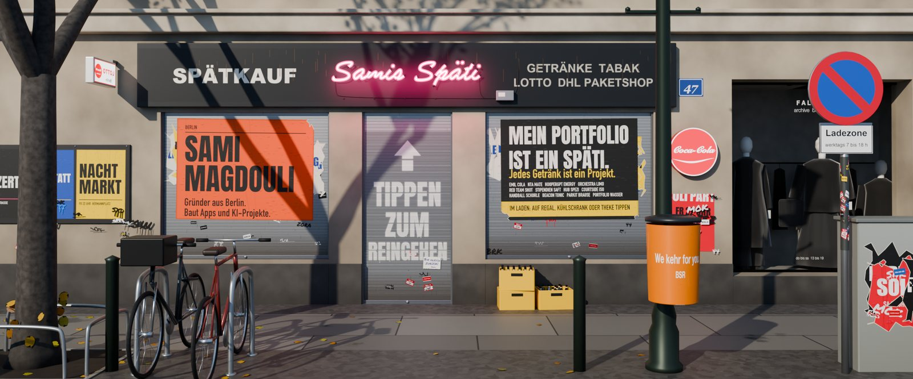
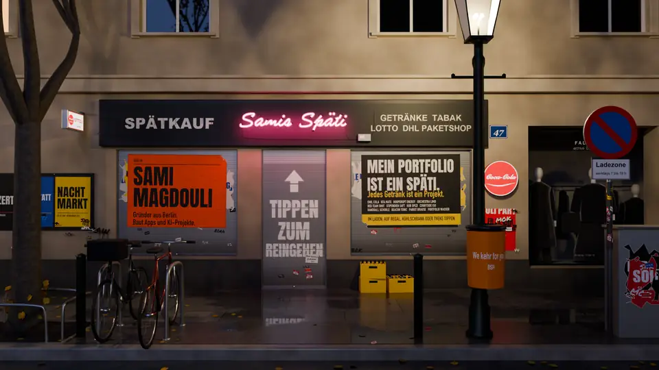

<a href="https://spaeti.5.45.109.195.sslip.io">
<picture>
  <source media="(prefers-color-scheme: dark)" srcset="assets/front-night.jpg">
  
</picture>
</a>

Ich baue KI-Agenten und Apps in Berlin. Mein Portfolio ist ein Späti. Jedes Getränk ist ein Projekt.

  <a href="https://spaeti.5.45.109.195.sslip.io"><b>Späti</b></a> &nbsp;·&nbsp;
  <a href="https://www.linkedin.com/in/sami-magdouli-35b0393a1"><b>LinkedIn</b></a> &nbsp;·&nbsp;
  <a href="mailto:Sami-mag@web.de"><b>Mail</b></a>

### Building

| | |
|---|---|
| **Emil** | Personal AI assistant on WhatsApp and Telegram: one orchestrator, nine specialist agents, runs my mail and calendar. Public part: [scraping-agent-skeleton](https://github.com/sami-mag07/scraping-agent-skeleton) |
| **ParkIt** | What parking in Berlin actually costs right now. [App](https://github.com/sami-mag07/ParkIt) · [Web](https://github.com/sami-mag07/parkit-web) |
| **Beacon** | Crisis cockpit for winter blackouts, built at European Defense Tech Week Berlin 2026. |
| **AI workshops** | Ran workshops for teachers at my school. [Handouts](https://github.com/sami-mag07/ki-workshop-handouts) · [Fact checker](https://github.com/sami-mag07/ki-faktencheck) |

### Stack

<a href="https://spaeti.5.45.109.195.sslip.io"><b>Reinkommen</b></a>

