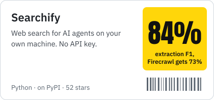
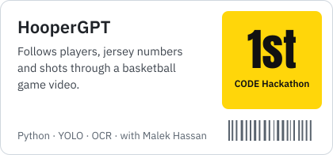
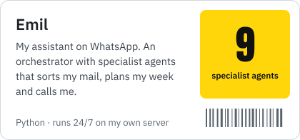
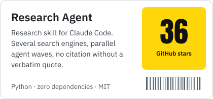
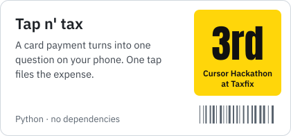
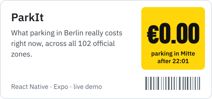
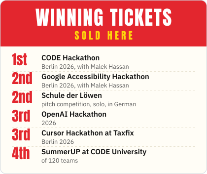
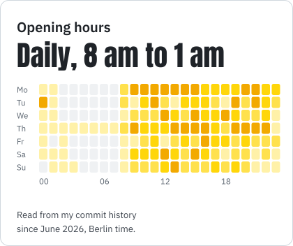

<a href="https://spaeti.5.45.109.195.sslip.io"><picture><source media="(prefers-color-scheme: dark)" srcset="assets/header-dark.svg"></picture></a>

  <a href="https://spaeti.5.45.109.195.sslip.io"><b>Website</b></a> &nbsp;·&nbsp;
  <a href="https://www.linkedin.com/in/sami-magdouli-35b0393a1"><b>LinkedIn</b></a> &nbsp;·&nbsp;
  <a href="mailto:Sami-mag@web.de"><b>Email</b></a>

I build AI agents and the tools under them: web search, extraction, research and computer vision. Technical researcher at a stealth startup in San Francisco. Coding since 2020.

## Projects

<a href="https://github.com/sami-mag07/searchify"><picture><source media="(prefers-color-scheme: dark)" srcset="assets/tags/searchify-dark.svg"></picture></a>
<a href="https://github.com/Malek1414/code-hackathon-project"><picture><source media="(prefers-color-scheme: dark)" srcset="assets/tags/hoopergpt-dark.svg"></picture></a>
<picture><source media="(prefers-color-scheme: dark)" srcset="assets/tags/emil-dark.svg"></picture>
<a href="https://github.com/sami-mag07/ultimate-scraper-agent"><picture><source media="(prefers-color-scheme: dark)" srcset="assets/tags/research-agent-dark.svg"></picture></a>
<a href="https://github.com/sami-mag07/tapntax"><picture><source media="(prefers-color-scheme: dark)" srcset="assets/tags/tapntax-dark.svg"></picture></a>
<a href="https://github.com/sami-mag07/ParkIt"><picture><source media="(prefers-color-scheme: dark)" srcset="assets/tags/parkit-dark.svg"></picture></a>

<picture><source media="(prefers-color-scheme: dark)" srcset="assets/wins-dark.svg"></picture>
<picture><source media="(prefers-color-scheme: dark)" srcset="assets/hours-dark.svg"></picture>

