<a href="https://spaeti.5.45.109.195.sslip.io">
<picture>
  <source media="(prefers-color-scheme: dark)" srcset="assets/front-night.jpg">
  
</picture>
</a>

Ich baue KI-Agenten und Apps in Berlin. Mein Portfolio ist ein Späti. Jedes Getränk ist ein Projekt.

  <a href="https://spaeti.5.45.109.195.sslip.io"><b>Späti</b></a> &nbsp;·&nbsp;
  <a href="https://www.linkedin.com/in/sami-magdouli-35b0393a1"><b>LinkedIn</b></a> &nbsp;·&nbsp;
  <a href="mailto:Sami-mag@web.de"><b>Mail</b></a>

<!-- kuehlschrank:start -->
## Kühlschrank

<table>
<tr><td align="center" valign="top" width="33%"><a href="https://github.com/sami-mag07/searchify">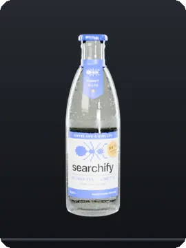</a> <a href="https://github.com/sami-mag07/searchify"><b>Searchify Eistee</b></a> Mein Research-Agent: sucht parallel über mehrere Suchdienste und lässt kein Zitat durch, das in keiner Quelle steht.</td><td align="center" valign="top" width="33%">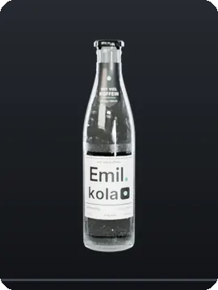 <b>Emil Cola</b> Ein Orchestrator mit 9 Spezialisten. Sortiert Mails, plant Termine, ruft mich an. Läuft über WhatsApp.</td><td align="center" valign="top" width="33%">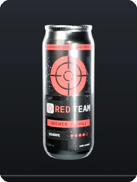 <b>Red Team Shot</b> Greift meine eigenen Apps an: Recon, Secret-Scan, Prompt-Injection gegen Emil, Retest nach jedem Fix.</td></tr>
<tr><td align="center" valign="top" width="33%"><a href="https://github.com/sami-mag07/tapntax">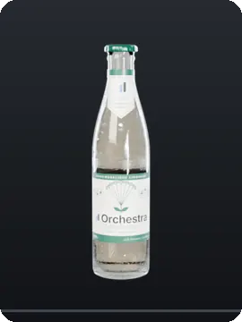</a> <a href="https://github.com/sami-mag07/tapntax"><b>Orchestra Limo</b></a> Geschäftskarte bezahlt, eine Frage aufs Telefon, ein Tap und der Beleg liegt in der Steuerakte.</td><td align="center" valign="top" width="33%">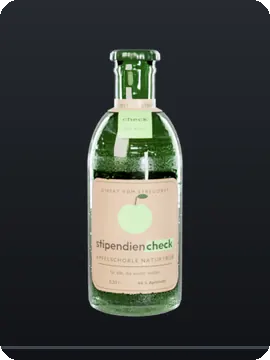 <b>Stipendien Saft</b> Findet Stipendien, die wirklich passen. Das CRM dahinter läuft im Emil-Dashboard.</td><td align="center" valign="top" width="33%"><a href="https://github.com/sami-mag07/hub">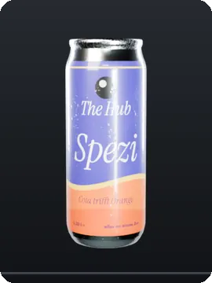</a> <a href="https://github.com/sami-mag07/hub"><b>Hub Spezi</b></a> Alle Hackathons, Aufgaben und Notizen von Malek und mir an einem Ort.</td></tr>
<tr><td align="center" valign="top" width="33%">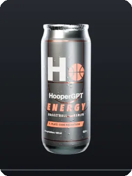 <b>HooperGPT Energy</b> Erkennt Spieler, Trikotnummern und Würfe aus dem Spielvideo. YOLO, Kalman-Filter, OCR.</td><td align="center" valign="top" width="33%">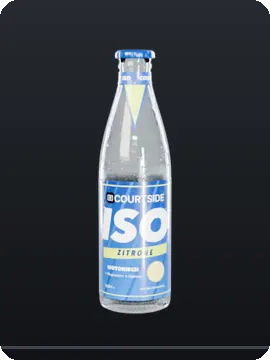 <b>Courtside Iso</b> Videoanalyse für Spiele, im August von Basketball auf Fußball erweitert.</td><td align="center" valign="top" width="33%">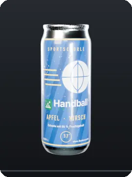 <b>Handball Schorle</b> Port von FollowCam auf Handball, getestet an einem kompletten Spiel.</td></tr>
<tr><td align="center" valign="top" width="33%">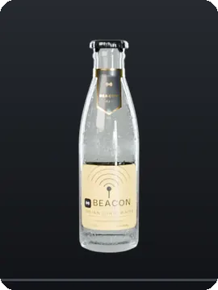 <b>Beacon Tonic</b> Krisen-Cockpit für einen Stromausfall. Zeigt, was zu tun ist, wenn nichts mehr geht.</td><td align="center" valign="top" width="33%"><a href="https://parkit.5.45.109.195.sslip.io">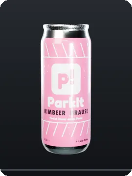</a> <a href="https://parkit.5.45.109.195.sslip.io"><b>ParkIt Brause</b></a> Zeigt, was Parken in Berlin gerade kostet, bevor du losfährst.</td><td align="center" valign="top" width="33%"><a href="https://portfolio.5.45.109.195.sslip.io">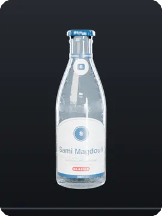</a> <a href="https://portfolio.5.45.109.195.sslip.io"><b>Portfolio Wasser</b></a> Mein Portfolio als macOS Tahoe nachgebaut, mit Emil in der Notch.</td></tr>
</table>
<!-- kuehlschrank:end -->

<!-- pokale:start -->
## Pokale

<table>
<tr><td align="center" valign="top" width="33%">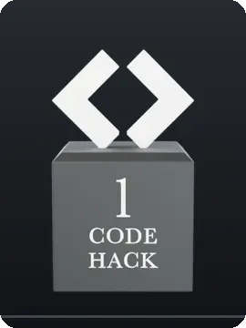 <b>1. Platz CODE-Hackathon</b> Mit Malek HooperGPT in einem Tag gebaut, damals hieß es noch FollowCam.</td><td align="center" valign="top" width="33%"><a href="https://github.com/sami-mag07/doorway">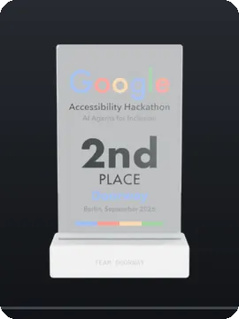</a> <a href="https://github.com/sami-mag07/doorway"><b>2. Platz Google Accessibility Hackathon</b></a> Mit Malek Doorway gebaut: zeigt Rollstuhlnutzern und blinden Menschen, welcher Eingang für sie funktioniert.</td><td align="center" valign="top" width="33%">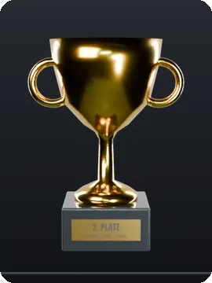 <b>2. Platz Schule der Löwen</b> Mein erster Pitch allein und auf Deutsch. Vier Stimmen hinter Platz eins.</td></tr>
</table>

Dazu 3. Platz beim OpenAI Hackathon, 3. Platz beim Cursor Hackathon und 4. Platz bei SummerUP von 120 Teams.
<!-- pokale:end -->

<a href="https://spaeti.5.45.109.195.sslip.io"><b>Reinkommen</b></a>

